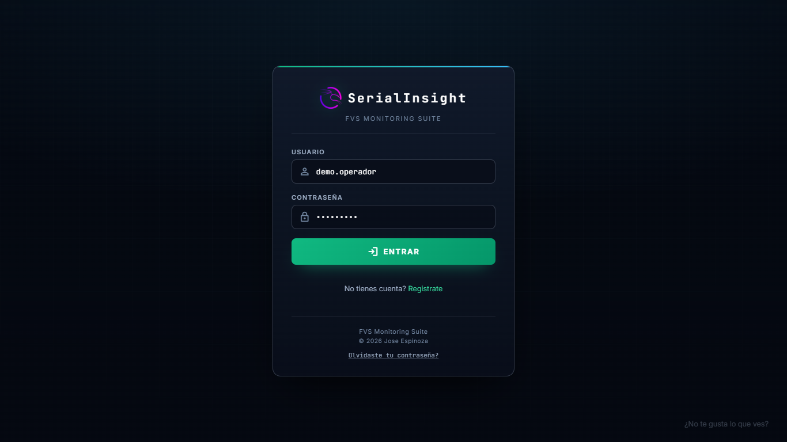
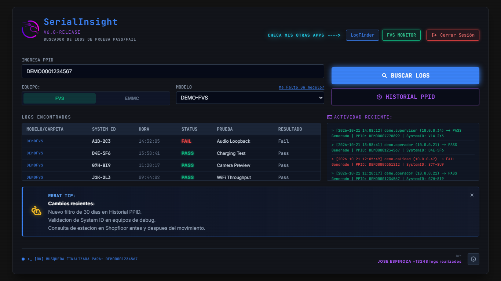
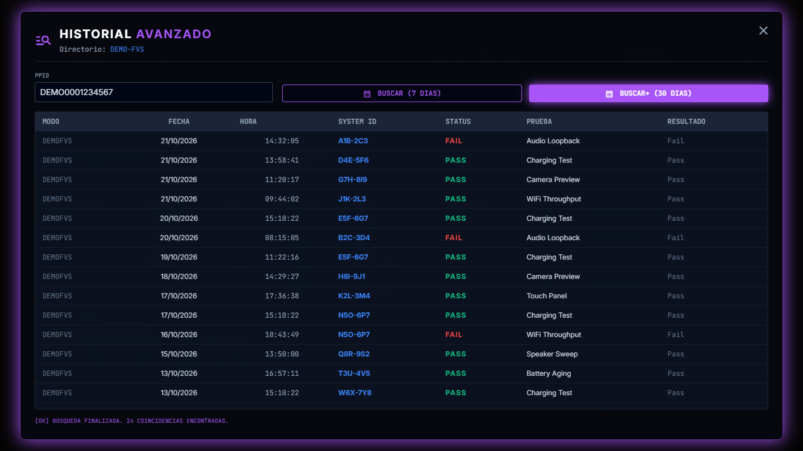
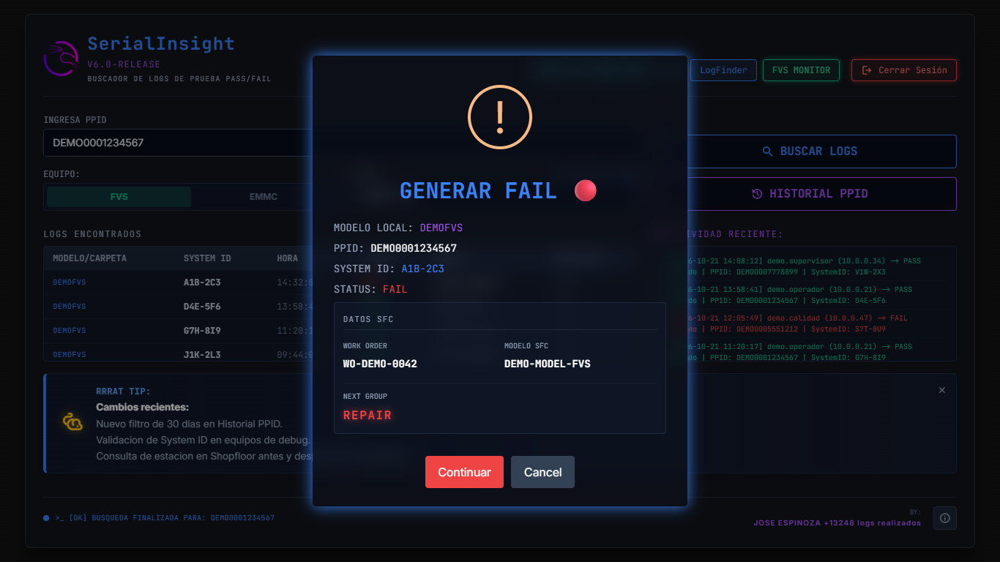
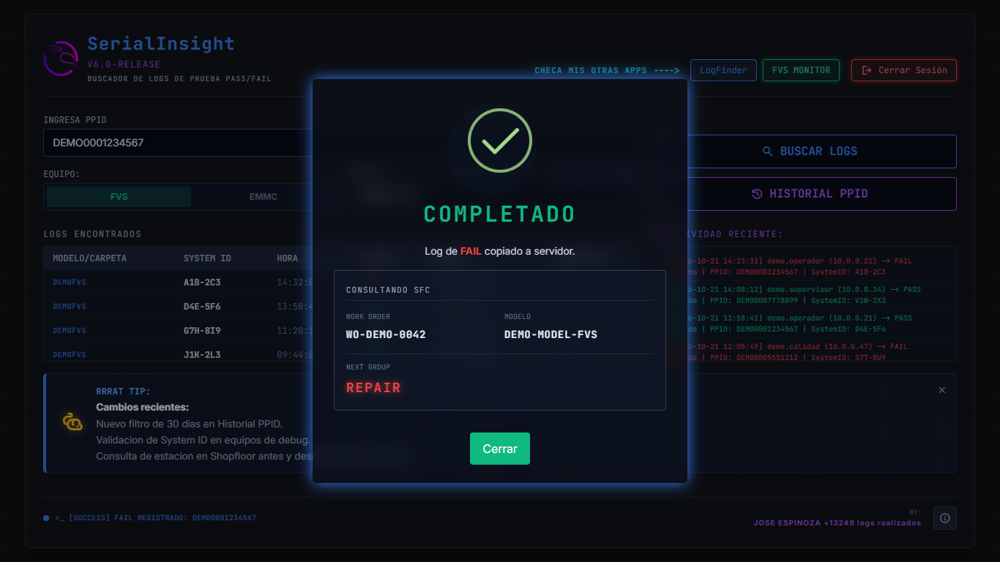
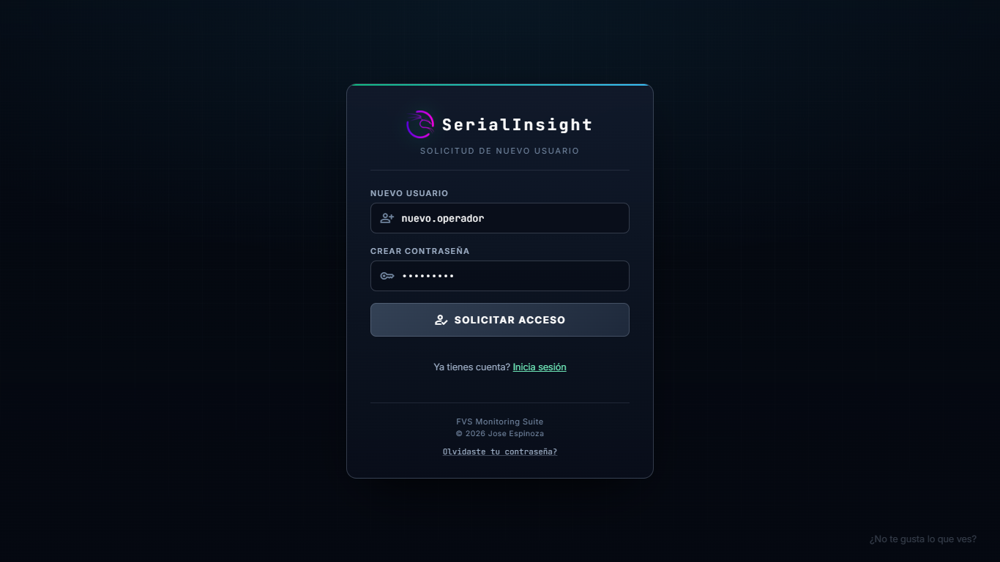
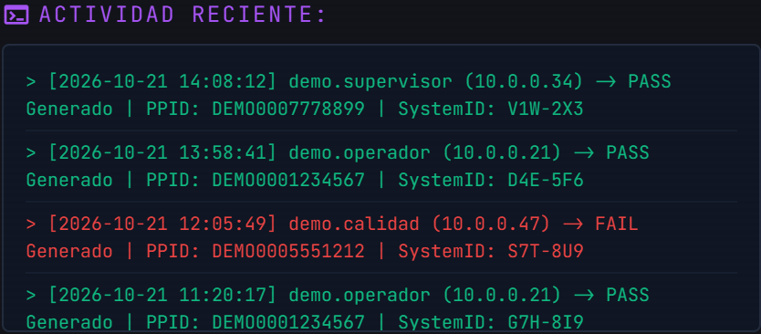
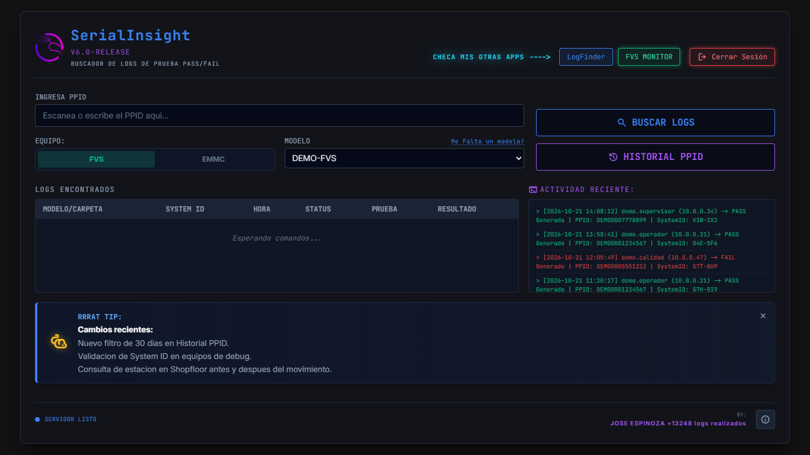

# Interfaz y funcionalidades

---

## Inicio de sesión

Acceso con usuario y contraseña. Las cuentas nuevas quedan registradas como pendientes de autorización antes de poder entrar.

---

## Búsqueda de logs

Búsqueda por número de serie en modo dual FVS/EMMC. La tabla muestra el modelo o carpeta de origen, el System ID, la hora, el status, la prueba y el resultado de cada coincidencia.

---

## Historial extendido (PPID+)

Rastreo de un serial en los logs de hasta 30 días atrás, con la fecha, la hora, la estación y el resultado de cada ocurrencia encontrada.

---

## Generar PASS / FAIL

Al seleccionar un resultado se habilitan las acciones de PASS o FAIL. Antes de procesar se consulta Shopfloor y se valida el System ID del equipo de prueba.

---

## Validación con Shopfloor

Al terminar el movimiento se consulta de nuevo la unidad para confirmar la estación y el siguiente grupo al que será enviada.

---

## Control de accesos

Registro y control de usuarios. Cada solicitud de cuenta queda pendiente de autorización y las cuentas se administran desde un archivo central.

---

## Log de auditoría

Actividad reciente con fecha, hora, usuario, IP, tipo de acción, PPID y System ID de cada movimiento realizado.

---

## Tablero de anuncios

Avisos de cambios en la plataforma y consejos de uso dentro del tablero principal.

---

  <a href="README.md">Volver al README principal</a>

